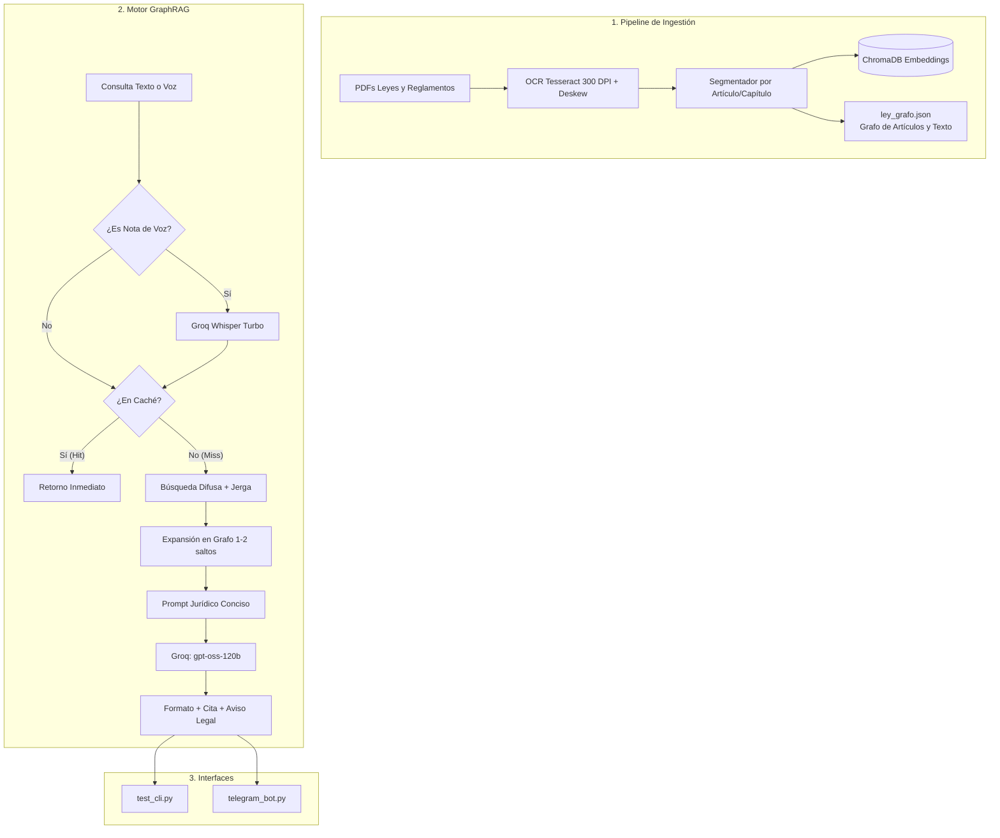

# VIALIA: Asistente Legal Vial de Oaxaca de Juárez (GraphRAG + Telegram Bot)

[](https://opensource.org/licenses/MIT)
[](https://www.python.org/)
[](https://groq.com)

**VIALIA** es un asistente jurídico de código abierto y libre acceso orientado a brindar información clara a la ciudadanía sobre tránsito, vialidad, multas, grúas y movilidad en el **Municipio de Oaxaca de Juárez** y el Estado de Oaxaca.

El sistema integra técnicas de **GraphRAG** (recuperación aumentada mediante grafos de conocimiento legal), búsqueda léxico-difusa optimizada para jerga popular mexicana, modelos abiertos de lenguaje (`openai/gpt-oss-120b` en Groq), transcripción de notas de voz con **Whisper** y un **Bot interactivo de Telegram**.

---

## Estado del Proyecto y Limitaciones Actuales

> [!WARNING]
> **Fase temprana de desarrollo (Early Stage):**
> - **Concurrencia:** Actualmente el bot está diseñado con limitaciones operativas de **un usuario a la vez**. Si múltiples usuarios envían consultas en simultáneo, las solicitudes se procesan de forma secuencial.
> - **Ejecución local requerida:** El bot no se encuentra desplegado en un servidor en la nube permanente. Para que el bot responda mensajes en Telegram, **la instancia del script `telegram_bot.py` debe estar activamente en ejecución en tu computadora**. Si el proceso local se apaga o la máquina entra en suspensión, el bot dejará de responder.

---

## Normativas y Documentos Indexados

El sistema indexa de forma estructurada (por capítulo y artículo) la normativa vigente, priorizando el ámbito municipal sobre el estatal:

1. **Reglamento de Tránsito Metropolitano del Municipio de Oaxaca de Juárez** (*Ámbito Municipal - Prioritario*).
2. **Ley de Movilidad para el Estado de Oaxaca** (*Ámbito Estatal*).
3. **Ley de Tránsito y Vialidad del Estado de Oaxaca** (*Ámbito Estatal*).
4. **Ley de Ingresos del Estado de Oaxaca para el Ejercicio Fiscal 2026** (*Ámbito Estatal*).
5. **Iniciativas y Decretos de Reforma Vial** (documentos auxiliares digitalizados con OCR de alta resolución).

---

## Capacidades y Funcionamiento

- **Motor GraphRAG Topológico:** En lugar de depender únicamente de similitud semántica plana, utiliza un grafo de conocimiento (`ley_grafo.json`) que conecta artículos secuenciales y temáticos. Al detectar un artículo relevante, el motor puede expandir la búsqueda 1 o 2 saltos topológicos para incluir artículos contiguos esenciales de la misma ley.
- **Tolerancia a Jerga y Coloquialismos:** Mapea términos del lenguaje cotidiano mexicano (*«troca»*, *«remolcaron»*, *«corralón»*, *«mordida»*, *«borracho»*, *«doble fila»*, *«poli»*) hacia los conceptos formales de la ley (*vehículo, arrastre, depósito oficial, cohecho, alcoholimetría, estacionamiento prohibido*).
- **Procesamiento de Notas de Voz:** Permite a los usuarios enviar mensajes o notas de voz en Telegram. El bot descarga el audio en memoria, lo transcribe en segundos utilizando `whisper-large-v3-turbo` y pasa la transcripción al motor GraphRAG como una consulta regular.
- **Caché en Memoria:** Las preguntas frecuentes idénticas se resuelven en milisegundos desde la memoria RAM, evitando llamadas redundantes al modelo de lenguaje.
- **Visor Interactivo de Artículos:** Cada respuesta incluye botones interactivos con los artículos citados. Al pulsar un botón, el bot muestra el texto íntegro y original del artículo almacenado en el grafo, empleando identificadores optimizados para respetar las restricciones de tamaño de Telegram.
- **Respuestas Concretas y Fundamentadas:** Respuestas directas sin introducciones innecesarias, con citas formales de la normativa correspondiente y aviso legal automático.
- **Modo Degradado Resiliente:** Si el servicio del modelo de lenguaje experimenta saturación o no cuenta con conexión, el sistema entra en modo degradado y extrae fragmentos literales de los artículos más relevantes directamente desde el grafo local.

---

## Arquitectura del Sistema



---

## Instalación y Puesta en Marcha

### Prerrequisitos
- Python 3.10 o superior.
- Git.
- Opcional: Tesseract OCR y `poppler-utils` (únicamente requerido si se desea reingestar PDFs desde cero).

### 1. Clonar el repositorio
```bash
git clone https://github.com/JaimeVGA/Hacktoberfest.git
cd Hacktoberfest
```

### 2. Crear y activar entorno virtual
```bash
python3 -m venv .venv
source .venv/bin/activate
```

### 3. Instalar dependencias
```bash
pip install -r requirements.txt
```

### 4. Configurar variables de entorno
Copia la plantilla de configuración:
```bash
cp .env.example .env
```

Edita `.env` con tus claves correspondientes:
```ini
GROQ_API_KEY=gsk_tu_clave_de_groq
TELEGRAM_BOT_TOKEN=tu_token_de_botfather
GROQ_MODEL=openai/gpt-oss-120b
```

---

## Modo de Uso

### A. Bot de Telegram
Para interactuar con el bot, inicia el proceso en tu terminal local:
```bash
python telegram_bot.py
```

> [!NOTE]
> Recuerda mantener esta terminal abierta y en ejecución en tu computadora mientras desees utilizar el bot.

- Busca tu bot en Telegram o envía el comando `/start`.
- Puedes seleccionar preguntas frecuentes de los botones, escribir consultas o enviar **notas de voz**.
- Consulta artículos completos pulsando los botones al pie de cada respuesta.

### B. Consola Interactiva (CLI)
Para probar consultas locales directamente en terminal sin Telegram:
```bash
python test_cli.py --debug
```
*Comandos disponibles en el CLI: `/hops 1|2`, `/k N`, `/debug`, `/salir`.*

### C. Reindexar Documentos (Opcional)
Si se añaden nuevos reglamentos o PDFs al proyecto:
```bash
python Conversion.py ingest
```
*Esto reconstruirá `chroma_db/` y `ley_grafo.json` con los textos y relaciones actualizados.*

---

## Pruebas Automatizadas

El proyecto incluye una suite de pruebas con `pytest` que verifica la normalización de texto, mapeo de jerga, expansión topológica del grafo, manejo de notas de voz simuladas, restricciones de bytes en Telegram y caché en memoria:

```bash
python -m pytest -v
```

---

## Exención de Responsabilidad Legal (Disclaimer)

Este software es una herramienta informativa y de divulgación ciudadana. Las respuestas generadas se fundamentan en el texto digitalizado de las leyes y reglamentos, pero no constituyen asesoramiento jurídico formal. Para casos específicos y controversias legales, consulte a un profesional del derecho o a las dependencias gubernamentales competentes.

---

## Licencia

Este proyecto está distribuido bajo la licencia libre y de código abierto **MIT License**. Consulta el archivo [LICENSE](LICENSE) para más detalles.
